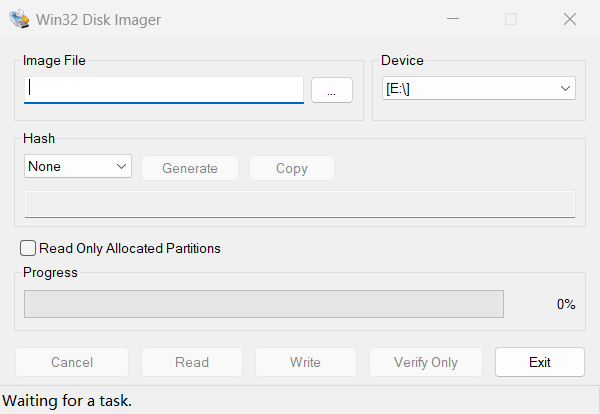
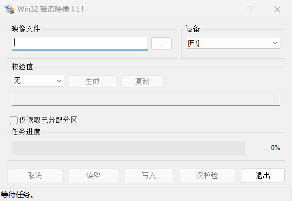
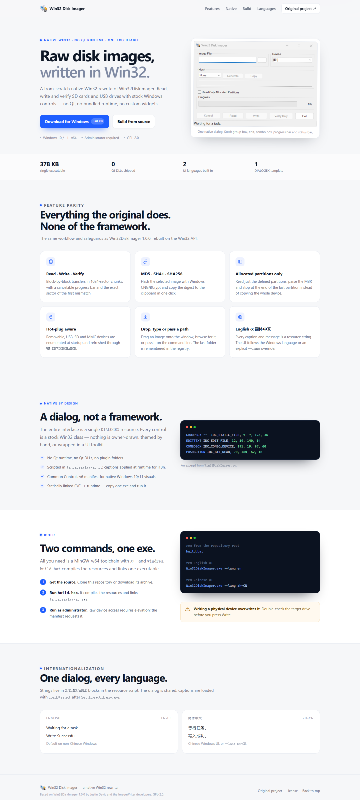

# Win32 Disk Imager — native Win32 rewrite

A from-scratch native Win32 rewrite of **Win32DiskImager 1.0.0**: read, write
and verify SD cards and USB drives with one small executable and a plain
Windows dialog. There is no Qt, no custom-drawn control and no owner-draw code.



The application is a single C++ source file plus the resource script, and
builds to one executable.

## Original project

This rewrite is based on the original **Win32DiskImager 1.0.0**, created by
Justin Davis and maintained by the ImageWriter developers:

* Project page: <https://sourceforge.net/projects/win32diskimager/>
* Original source tree: <https://sourceforge.net/p/win32diskimager/code/ci/master/tree/>
* Original license: GPL-2.0

The original Qt sources are not part of this repository. The rewrite keeps the
same workflow, window layout and registry key
(`HKCU\Software\Win32DiskImager\Settings`) while replacing the Qt UI with a
native Win32 dialog.

Copyright (C) 2009 Justin Davis and the ImageWriter developers.

## Features

* Read a device to an image file and write an image file to a device.
* Verify an image file against a device, with the sector of the first mismatch.
* MD5, SHA1 and SHA256 hashes of the image file, with copy to the clipboard.
* “Read Only Allocated Partitions”: stop reading at the end of the last MBR
  partition.
* Removable/USB/SD/MMC device enumeration, hot-plug add/remove, drive label in
  the write confirmation, free-space check when reading.
* Drag and drop an image file onto the window or the file box, command-line
  image argument, last folder remembered in the registry.
* Progress bar, transfer speed and elapsed/remaining time in the status bar,
  cancellable long operations.
* Localized UI and messages (English and Simplified Chinese) selected from the
  Windows UI language, overridable with `--lang`.

## Layout

```
main.cpp                  application, disk layer, hashing, i18n
Win32DiskImager.rc        DIALOGEX template, icons, version, string tables
resource.h                control and string IDs
Win32DiskImager.manifest  admin level, Common Controls v6, DPI awareness
Win32DiskImager.ico       application icon
build.bat                 build script
screenshot-en.png         English UI
screenshot-zh.png         Chinese UI
LICENSE                   GPL-2.0 text
doc/index.html            single-page landing page for GitHub Pages
```

## Build

Requires a MinGW-w64 toolchain (`g++` and `windres`). Tested with llvm-mingw
20261020. From the repository root:

```bat
build.bat
```

This produces `Win32DiskImager.exe` (64-bit). The script looks for
`g++`/`windres` on `PATH`; when they are not there it falls back to the
llvm-mingw copy installed by NS Port Builder. Set `CXX` / `RC` to use another
compiler or resource compiler. The C++ runtime is linked statically; only the
Windows UCRT delivered with Windows 10/11 is used at runtime.

The executable embeds a manifest that requests administrator rights for raw
disk access, enables Common Controls v6 (native themed controls) and declares
DPI awareness. The RC file is UTF-8; `windres` is invoked with
`--codepage=65001`.

## Run

```bat
Win32DiskImager.exe [--lang en|zh-CN] [image-file]
```

`--lang` is only a test/override switch: without it the app uses Simplified
Chinese when the Windows UI language is Chinese and English otherwise. The
image argument is pre-filled in the Image File box.

## Internationalization

Every user-visible string is a resource in `Win32DiskImager.rc`: UI captions,
message boxes, error texts and the file dialog filter label. Each language is
a `STRINGTABLE` block tagged with `LANGUAGE`; the dialog template is shared and
all captions are applied at runtime, so adding a language does not duplicate
the dialog.

To add a language:

1. Copy one `STRINGTABLE` block in `Win32DiskImager.rc`.
2. Change its `LANGUAGE` line and translate the values (keep the `%u`, `%s`,
   `%llu` placeholders in the same order).
3. Teach `PickLanguage()` in `main.cpp` to return its `LANGID`, or pass it with
   `--lang`.

Strings are loaded with `LoadStringW` after `SetThreadUILanguage`, so the
resource loader picks the matching language block.



## Landing page

`doc/index.html` is a self-contained single-page site (inline CSS, one
screenshot, no external requests). Publish the contents of `doc/` as the
GitHub Pages root, or point Pages at `doc/` and keep the relative paths intact.
The page links to `Win32DiskImager.exe` inside `doc/` for a direct download.

> GitHub Pages' branch publishing offers the repository root or `/docs`, not
> an arbitrary folder. Rename `doc/` to `docs/` or copy its contents to the
> Pages root before enabling Pages; the relative links stay the same.



## Implementation notes

* The UI is written directly against the Win32 API rather than through WTL.
  WTL is a template layer over ATL, and ATL is only distributed with MSVC;
  this build environment has no MSVC/ATL. The message/dialog model, native
  Common Controls and resource-driven layout are the same ones WTL wraps, and
  the binary has no UI framework dependency.
* The status bar shows transfer speed while working and elapsed/remaining time
  on the right; the progress bar and percentage live in the Progress group.
* No raw-disk write test is shipped with the source for obvious safety
  reasons; the image/device code is a direct port of the original logic.

## License

GPL-2.0. See [LICENSE](LICENSE). The original Win32DiskImager is also
GPL-2.0; see the original project links above.
